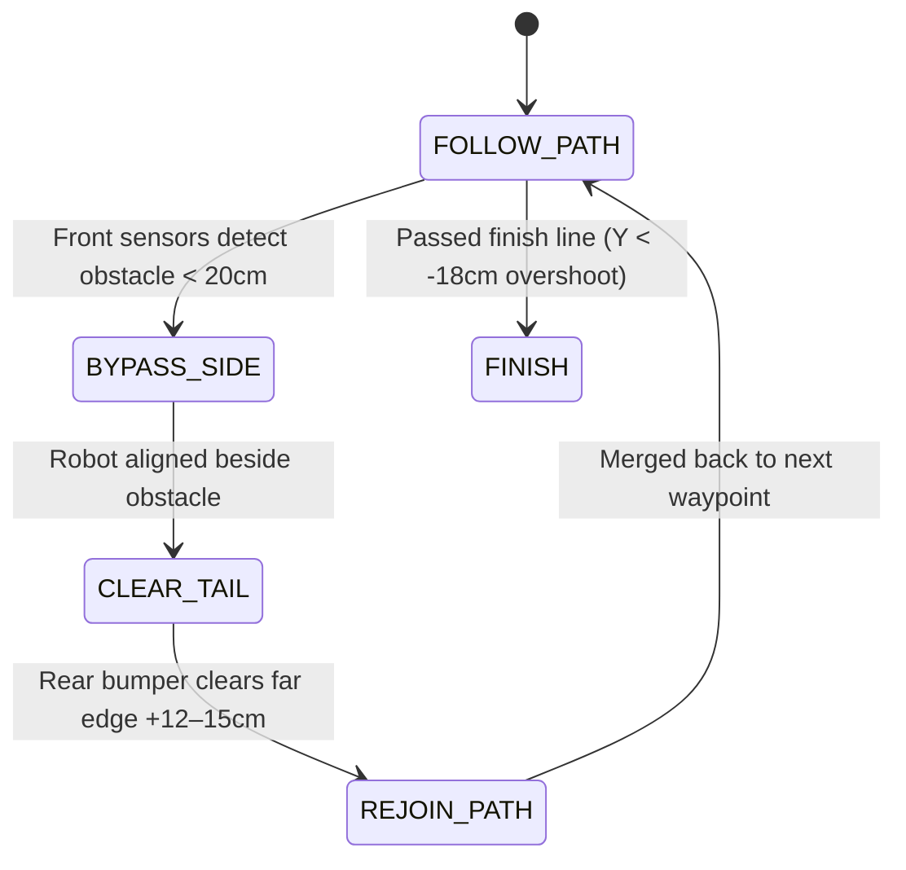

# U-Maze Obstacle-Avoidance Robot — Complete Reference

> [!IMPORTANT]
> This document is the **single source of truth** for every design decision. All firmware code
> in `firmware_micromouse` must conform to the specs below. When in doubt, re-read this file.

---

## 1. Competition Arena & Rules

### 1.1 Arena Layout (U-Shape)

| Parameter | Value |
|---|---|
| Overall size | 180 × 120 cm |
| Tiles | 6 tiles of 60 × 60 cm |
| Boundary & forbidden zone | Black adhesive tape (borders + center island of the U) |
| Max robot size | 15 × 10 cm (target: ≈ 12.5 × 8.5 cm) |
| Obstacle cubes | White foam 10 × 10 × 10 cm |

```
  Y=120 ┌─────────────────────────────────┐
        │  ┌─────────────────┐            │
        │  │  FORBIDDEN ZONE │  Gate A    │ ← Ô góc phải (marks 1,2,3)
        │  │  (center of U)  │  (random)  │
        │  └─────────────────┘            │
        │         U-channel               │
        │  Static obstacles               │
  Y=0   └──START──────────────FINISH──────┘
  X=0                                   X=180
        Origin (0,0) = bottom-left corner
```

### 1.2 Match Flow

| Phase | Duration | Description |
|---|---|---|
| **Round 1 — Manual** | Max 3 min | Drive by hand (Bluetooth RC). Scan static obstacles. Finish early → surplus time rolls over. Free to modify/reflash code between rounds. |
| **Round 2 — Autonomous** | 4 min + surplus | Two random obstacles drawn after locking car at Ô góc phải (marks 1/2/3) and Ô đích (marks 4/5/6). Score is only from this round. |

### 1.3 Scoring (Round 2 Only)

| Event | Points |
|---|---|
| Pass a **static** obstacle (rear bumper clears far edge line, cube undisturbed) | **+10** |
| Pass a **random** obstacle (same rule) | **+15** |
| Cross the **finish line** (entire car past it) | **+40** |
| **Clean run** (zero penalties) | **+10** |
| **Speed bonus** | **(240 − t) / 6** where t = seconds |

| Penalty | Points |
|---|---|
| Wheel / caster ball fully outside black line | **−5** |
| Obstacle displaced or toppled (also loses obstacle points) | **−5** |
| Manual reset (lift & place within 20 cm of last cleared obstacle, press button to resume) | **−10 each** |

### 1.4 Strategy: "Chậm Mà Chắc" (Slow but Sure)

* 6 seconds slower ≈ −1 point speed; one penalty ≈ −15 to −30 points.
* Chassis target ≈ 12.5 × 8.5 cm, wheels + caster recessed toward center → nose can overshoot black line without wheel penalty.
* Round 1: finish manual scan in **30–45 s** → roll over **> 2 min** to Round 2.
* Moderate cruising speed; never rush.

---

## 2. Hardware Architecture

### 2.1 Power Topology

```
 ┌──────────┐
 │ 12V LiPo │
 └────┬─────┘
      │
      ├──► VM pin TB6612FNG ──► Motor Left (AO1/AO2)
      │    (add 100µF–470µF bulk cap                ──► Motor Right (BO1/BO2)
      │     parallel to existing 100nF near VM/GND)
      │
      └──► Buck 12V→5V IN+
                 │
                 ├──► Black Pill 5V pin (VBUS)
                 │    ⚠️ NEVER connect USB-C or ST-Link 3V3 while battery ON
                 │
                 └──► HC-05 VCC (5V)

     Black Pill on-board AP7343 LDO: 5V → 3.3V
                 │
                 ├──► TB6612FNG VCC (logic 3.3V)
                 ├──► 5× VL53L0X VIN (3.3V)
                 ├──► MPU6050 VCC (3.3V)
                 └──► 2× Encoder Hall VCC (3.3V)

     All GND connected together.
```

### 2.2 Components

| Component | Model / Link | Qty |
|---|---|---|
| MCU | WeAct STM32F411CEU6 Black Pill V2.0 | 1 |
| Motor Driver | TB6612FNG (Pololu #713) | 1 |
| DC Motors | N20 12V 200RPM (Waveshare DCGM-N20-12V-EN-200RPM) | 2 |
| Encoders | Hall encoder 6-wire (integrated on N20) | 2 |
| ToF Sensors | VL53L0X (I2C) | 5 |
| IMU | MPU6050 (GY-521) | 1 |
| Bluetooth | HC-05 | 1 |
| Buck Converter | 12V→5V module | 1 |
| Battery | 12V LiPo | 1 |

---

## 3. Pin Allocation — STM32F411CEU6

### 3.1 System Pins (Do Not Reassign)

| Pin | Function | Notes |
|---|---|---|
| PH0, PH1 | HSE 25 MHz Crystal | RCC → HSE: Crystal/Ceramic Resonator |
| PA13, PA14 | SWD (SWDIO, SWCLK) | SYS → Debug: Serial Wire — **never disable** |
| PC14, PC15, PB2, PA11, PA12 | **Unused** | Leave floating / not configured |

### 3.2 User I/O

| Pin | Direction | Function | Label |
|---|---|---|---|
| PA0 | **Input Pull-Up** | Start / Reset button (KEY) | `BTN_KEY` |
| PC13 | Output | On-board LED | `LED_ONBOARD` |

### 3.3 Motor Driver (TB6612FNG)

| Pin | Function | Peripheral | Notes |
|---|---|---|---|
| PA8 | TIM1_CH1 PWM | `PWMA` — Left motor | TIM1: Internal Clock, PSC=0, ARR=4999 → **20 kHz** @ 100 MHz |
| PA9 | TIM1_CH2 PWM | `PWMB` — Right motor | Same timer |
| PB12 | GPIO Output | `AIN1` | Left motor direction |
| PB13 | GPIO Output | `AIN2` | Left motor direction |
| PB14 | GPIO Output | `BIN1` | Right motor direction |
| PB15 | GPIO Output | `BIN2` | Right motor direction |
| PA10 | GPIO Output | `STBY` | Standby (HIGH = enabled) |

TB6612FNG outputs:
* AO1, AO2 → Motor Left (Red/White wires)
* BO1, BO2 → Motor Right (Red/White wires)

### 3.4 Encoders (Hardware Quadrature)

| Timer | Pins | Motor | Encoder Wires |
|---|---|---|---|
| TIM3 (Encoder Mode) | PA6 (CH1), PA7 (CH2) | Left | Yellow (A), Green (B) |
| TIM4 (Encoder Mode) | PB6 (CH1), PB7 (CH2) | Right | Yellow (A), Green (B) |

### 3.5 I2C Bus 1 — VL53L0X Sensors (5×)

| I2C | Pins | Speed |
|---|---|---|
| I2C1 | PB8 (SCL), PB9 (SDA) | **400 kHz** Fast Mode |

XSHUT pin sequencing for address reassignment (all init LOW):

| GPIO Pin | Sensor Position | New I2C Addr |
|---|---|---|
| PA1 | Left 90° | 0x30 |
| PA4 | Diagonal Left 45° | 0x31 |
| PA5 | Front Center 0° | 0x32 |
| PB0 | Diagonal Right 45° | 0x33 |
| PB1 | Right 90° | 0x34 |

> [!TIP]
> If total bus capacitance is too high with 5 sensors, remove extra pull-up resistors
> from some breakout boards. Keep only one pair of 4.7kΩ pull-ups on the bus.

### 3.6 I2C Bus 2 — MPU6050 (Dedicated)

| I2C | Pins | Speed |
|---|---|---|
| I2C2 | PB10 (SCL), PB3 (SDA, **AF9**) | **400 kHz** Fast Mode |

| Pin | Function |
|---|---|
| PB5 | GPIO_EXTI5 → MPU6050 INT (enable NVIC EXTI[9:5]) |
| AD0 | Wired to GND → I2C address **0x68** |

> [!IMPORTANT]
> Separating IMU on I2C2 ensures high-frequency PID gyro reads (≥1 kHz)
> are never blocked by slow VL53L0X ranging on I2C1 (~30 ms per sensor).

### 3.7 Bluetooth — HC-05

| I2C/UART | Pins | Config |
|---|---|---|
| USART2 (Async + DMA) | PA2 (TX→HC05 RXD), PA3 (RX←HC05 TXD) | 115200 baud, 8N1 |

Optional:
| Pin | Function |
|---|---|
| PB4 | HC-05 STATE |
| PA15 | HC-05 EN |

### 3.8 Complete Pin Map (Visual)

```
              STM32F411CEU6 Black Pill
        ┌──────────────────────────────────┐
        │                        USB-C     │
  B12 ──┤ AIN1              5V ├── Buck 5V / HC-05 VCC
  B13 ──┤ AIN2             GND ├── Common GND
  B14 ──┤ BIN1             3V3 ├── TB6612 VCC / VL53L0X / MPU / Encoder
  B15 ──┤ BIN2             B10 ├── I2C2_SCL (MPU6050)
   A8 ──┤ TIM1_CH1 PWMA     B3 ├── I2C2_SDA AF9 (MPU6050)
   A9 ──┤ TIM1_CH2 PWMB     B1 ├── XSHUT VL53L0X Right 90°
  A10 ──┤ STBY              B0 ├── XSHUT VL53L0X Diag Right 45°
  A13 ──┤ SWDIO             A7 ├── TIM3_CH2 Encoder Left B
  A14 ──┤ SWCLK             A6 ├── TIM3_CH1 Encoder Left A
  A15 ──┤ HC05 EN (opt)     A5 ├── XSHUT VL53L0X Front 0°
   B5 ──┤ MPU INT EXTI5     A4 ├── XSHUT VL53L0X Diag Left 45°
   B6 ──┤ TIM4_CH1 EncR A   A3 ├── USART2_RX ← HC05 TXD
   B7 ──┤ TIM4_CH2 EncR B   A2 ├── USART2_TX → HC05 RXD
   B8 ──┤ I2C1_SCL (5×ToF)  A1 ├── XSHUT VL53L0X Left 90°
   B9 ──┤ I2C1_SDA (5×ToF)  A0 ├── BTN_KEY (Input Pull-Up)
   B4 ──┤ HC05 STATE (opt) C13 ├── LED_ONBOARD
        └──────────────────────────────────┘
  Unused: PC14, PC15, PB2, PA11, PA12
```

---

## 4. STM32CubeMX Configuration Checklist

### 4.1 Clock Tree

| Setting | Value |
|---|---|
| HSE | 25 MHz Crystal (PH0/PH1) |
| PLL Source | HSE |
| PLLM | 25 (**not 12**) |
| PLLN | 200 |
| PLLP | /2 |
| SYSCLK = HCLK | **100 MHz** |
| APB1 | /2 → 50 MHz (TIM3, TIM4 APB1 timers get 2× = 100 MHz) |
| APB2 | /1 → 100 MHz (TIM1 on APB2) |

> [!WARNING]
> Current code has PLLM=12, PLLN=96 → HCLK = 25/12×96/2 = 100 MHz. This works
> arithmetically but PLLM=25 is cleaner (VCO_in = 1 MHz). Either is valid; just
> be consistent.

### 4.2 Debug

* SYS → Debug: **Serial Wire** (PA13/PA14) — prevents chip lock-out.

### 4.3 TIM1 — PWM Motor Control

| Parameter | Value |
|---|---|
| Clock Source | Internal Clock |
| Channel 1 | PWM Generation CH1 |
| Channel 2 | PWM Generation CH2 |
| Prescaler (PSC) | **0** |
| Auto-Reload (ARR) | **4999** |
| PWM Frequency | 100 MHz / (0+1) / (4999+1) = **20 kHz** |
| Duty Cycle | Set CCR1/CCR2 at runtime (0–4999) |

### 4.4 TIM3 & TIM4 — Encoder Mode

| Parameter | Value |
|---|---|
| Mode | Encoder Mode (TI1 or TI12) |
| PSC | 0 |
| ARR | 65535 (16-bit full range) |
| IC Filter | 4–8 recommended for noise rejection |

### 4.5 I2C1 — VL53L0X Bus

| Parameter | Value |
|---|---|
| Speed | **400000** (Fast Mode) |
| Pins | PB8 (SCL), PB9 (SDA) |

### 4.6 I2C2 — MPU6050 Bus

| Parameter | Value |
|---|---|
| Speed | **400000** (Fast Mode) |
| Pins | PB10 (SCL), PB3 (SDA) — **AF9** |

### 4.7 USART2 — HC-05 Bluetooth

| Parameter | Value |
|---|---|
| Mode | Asynchronous |
| Baud Rate | 115200 |
| DMA | TX: DMA1_Stream6_Ch4, RX: DMA1_Stream5_Ch4 |

### 4.8 NVIC

| IRQ | Enable |
|---|---|
| EXTI[9:5] | ✅ (MPU6050 Data Ready on PB5) |
| DMA1_Stream5 | ✅ (USART2 RX DMA) |
| DMA1_Stream6 | ✅ (USART2 TX DMA) |

---

## 5. Software Architecture & Algorithms

### 5.1 Odometry

```
Every Δt (e.g., 10 ms from SysTick or TIM interrupt):

  ticksL = TIM3->CNT − prevL;   prevL = TIM3->CNT;   // handle 16-bit wrap
  ticksR = TIM4->CNT − prevR;   prevR = TIM4->CNT;

  distL = ticksL × mm_per_tick;
  distR = ticksR × mm_per_tick;
  Δs = (distL + distR) / 2;

  θ  = integrate gyro_Z from MPU6050 (more accurate than encoder-based heading)

  X += Δs × cos(θ)
  Y += Δs × sin(θ)
```

Coordinate system:
* Origin (0, 0) = bottom-left corner of arena
* X ∈ [0, 180] cm, Y ∈ [0, 120] cm

### 5.2 Obstacle Detection & Mapping (Round 1)

During manual drive, for each VL53L0X reading `d` at sensor angle `α` relative to heading:

```
obs_X = X + d × cos(θ + α)
obs_Y = Y + d × sin(θ + α)
```

Cluster nearby detections and store as obstacle center coordinates.

### 5.3 Bluetooth Telemetry Protocol (CSV)

Send via USART2 → HC-05 → PC COM port:

| Prefix | Format | Description |
|---|---|---|
| `POS` | `POS,X,Y,θ,ticksL,ticksR,timestamp` | Current pose |
| `OBS` | `OBS,id,X,Y,size` | Detected obstacle |
| `TRAJ` | `TRAJ,idx,X,Y` | Waypoint in trajectory |
| `STA` | `STA,state_name,checkpoint` | State machine status |

PC visualizer: Python (matplotlib / pygame) or Chrome Web Serial API.

### 5.4 Flash Storage — Sector 7

After Round 1 scan is complete and trajectory is confirmed:
* Erase Flash Sector 7 (128 KB, addr 0x0806_0000)
* Write waypoint array + obstacle map
* Read back on Round 2 boot

### 5.5 Waypoint-Following PID Controller

```
                      ┌────────────┐
  target_heading ──►  │  PID(θ)    ├──► ΔV (differential speed)
  current_θ      ──►  │  Kp,Ki,Kd  │
                      └────────────┘

  V_left  = V_base + ΔV
  V_right = V_base − ΔV

  PWM_left  = clamp(V_left  × scale, 0, 4999)
  PWM_right = clamp(V_right × scale, 0, 4999)
```

Look-ahead: aim at waypoint ~10–15 cm ahead of nearest waypoint on path.

### 5.6 Virtual Wall Clamping

**No physical line sensors needed.** In software:

```c
#define WALL_MARGIN_CM  10.0f   // min distance from black tape

// Clamp target position so robot never approaches boundary
target_X = clamp(target_X, WALL_MARGIN_CM, 180.0f - WALL_MARGIN_CM);
target_Y = clamp(target_Y, WALL_MARGIN_CM, 120.0f - WALL_MARGIN_CM);

// Also clamp against forbidden center island of the U
if (inside_forbidden_zone(target_X, target_Y)) {
    push_to_nearest_corridor(target_X, target_Y);
}
```

### 5.7 Obstacle Bypass State Machine (Round 2)



**BYPASS_SIDE details:**
* Shift laterally **18 cm** away from the obstacle, toward the side **farther from the U boundary**.
* Drive alongside the cube.
* **CLEAR_TAIL**: continue straight 12–15 cm past the far edge so the entire rear
  of the car clears the scoring line.

**Random obstacle scanning:**
* At Gate A (Ô góc phải): one of marks 1, 2, 3
* At Gate B (Ô đích): one of marks 4, 5, 6
* Method: compare VL53L0X readings against known positions; the new reading that
  doesn't match a static obstacle = random obstacle.

### 5.8 Checkpoint & Resume

After each obstacle is cleared, update `current_checkpoint`.

If manual reset occurs (penalty −10):
1. Robot is placed within 20 cm of the last cleared obstacle.
2. Press PA0 (KEY button).
3. Firmware reads `current_checkpoint`, resets odometry relative to that obstacle's
   known position, and resumes from the **next waypoint** — not from start.

### 5.9 Finish Overshoot

Drive past the finish line to Y = −18 cm to ensure the entire car body is beyond
the line before stopping.

---

## 6. Code Issues in Current CubeMX-Generated Code

> [!WARNING]
> The following discrepancies exist between the spec and the current generated code.
> These should be fixed in STM32CubeMX (`.ioc` file) or manually in code.

### 6.1 PA0 Configured as Output Instead of Input

**Spec**: PA0 = GPIO_Input with Pull-Up (start button)
**Current code** (`MX_GPIO_Init`): PA0 is `GPIO_MODE_OUTPUT_PP` with `GPIO_PULLUP`

**Fix**: Change to `GPIO_MODE_INPUT` with `GPIO_PULLUP`.

### 6.2 I2C1 & I2C2 at 100 kHz Instead of 400 kHz

**Spec**: Both I2C buses should be Fast Mode 400 kHz
**Current code**: `ClockSpeed = 100000`

**Fix**: Set `hi2c1.Init.ClockSpeed = 400000` and `hi2c2.Init.ClockSpeed = 400000`.

### 6.3 TIM1 ARR = 65535 Instead of 4999

**Spec**: ARR = 4999 for 20 kHz PWM
**Current code**: `htim1.Init.Period = 65535` → ~1.5 kHz PWM (inaudible range exceeded, motor whine)

**Fix**: Set `htim1.Init.Period = 4999`.

### 6.4 NVIC for EXTI[9:5] Not Enabled

**Spec**: Enable EXTI9_5 IRQ for MPU6050 INT on PB5
**Current code**: PB5 is configured as `GPIO_MODE_IT_RISING` but NVIC is not enabled in `MX_GPIO_Init`

**Fix**: Add `HAL_NVIC_SetPriority(EXTI9_5_IRQn, 1, 0)` and `HAL_NVIC_EnableIRQ(EXTI9_5_IRQn)`.

### 6.5 DMA Not Configured for USART2

**Spec**: USART2 with DMA for non-blocking Bluetooth telemetry
**Current code**: USART2 initialized without DMA

**Fix**: Enable DMA streams in CubeMX for USART2_TX and USART2_RX.

### 6.6 Encoder Filter Value = 0

**Spec**: Recommend IC filter 4–8 for noise rejection
**Current code**: `IC1Filter = 0` and `IC2Filter = 0` on both TIM3 and TIM4

**Fix**: Set filter to 4–8 (e.g., `sConfig.IC1Filter = 6; sConfig.IC2Filter = 6;`).

---

## 7. Module Decomposition (Recommended File Structure)

```
src/
├── main.c                  # Init + main loop + state machine
├── motor.c / motor.h       # TB6612FNG control (PWM + direction)
├── encoder.c / encoder.h   # Read TIM3/TIM4, compute Δticks
├── odometry.c / odometry.h # Pose (X, Y, θ) integration
├── pid.c / pid.h           # Generic PID controller
├── vl53l0x.c / vl53l0x.h   # VL53L0X driver (XSHUT sequencing, ranging)
├── mpu6050.c / mpu6050.h   # MPU6050 driver (gyro read, DMP optional)
├── bluetooth.c / bluetooth.h # USART2 DMA TX/RX, CSV protocol
├── obstacle.c / obstacle.h # Obstacle map, detection, clustering
├── path.c / path.h         # Waypoint storage, virtual wall, bypass FSM
├── flash.c / flash.h       # Sector 7 read/write for trajectory persistence
├── config.h                # All #defines (pin labels, PID gains, dimensions)
└── stm32f4xx_it.c          # IRQ handlers (encoder overflow, EXTI, DMA)
```

---

## 8. Key Physical Constants

| Parameter | Value | Notes |
|---|---|---|
| Wheel diameter | ~24 mm (N20 standard) | Measure actual |
| Encoder CPR | ~200 (motor shaft) × gear ratio | Check motor spec |
| mm_per_tick | π × wheel_dia / (CPR × 4) | Quadrature 4× mode |
| Wheel track (axle-to-axle) | ~70–80 mm | Measure actual |
| Sensor mount offsets | Measure from robot center | For accurate obstacle mapping |

---

*Last updated: 2026-10-23*

